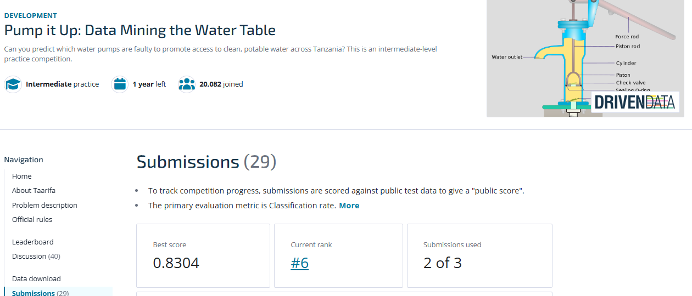
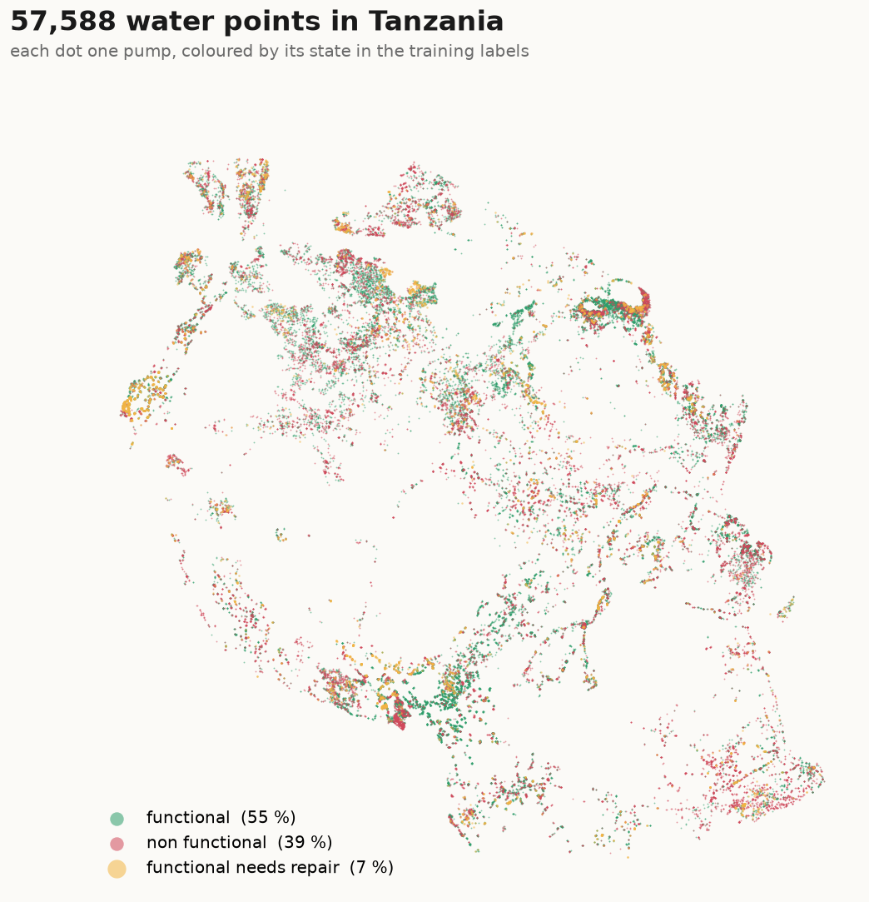
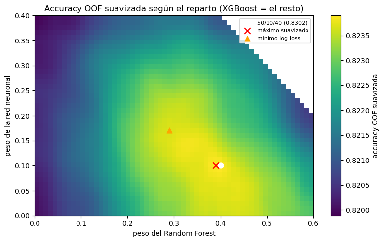

# Pump It Up: which water points in Tanzania still work?

The Machine Learning project of the MSc in Data Science, Big Data & Business Analytics at Universidad Complutense de Madrid, built on the DrivenData competition [*Pump it Up: Data Mining the Water Table*](https://www.drivendata.org/competitions/7/pump-it-up-data-mining-the-water-table/). The task is to predict, for 14,850 water points in Tanzania, whether each one is *functional*, *functional needs repair* or *non functional*, scored by accuracy on a hidden test set. Every idea is stated as a hypothesis, tested, and kept with the number that supports it.

| Result | Accuracy (test) | Leaderboard |
|---|---|---|
| Reproducible model (blend 70/20/10, weights fixed before seeing the test) | **0.8280** | #72 |
| Blend weights chosen by out-of-fold validation (50/10/40) | 0.8302 | |
| 50/10/40 + label of training points at the same exact coordinates | **0.8304** | **#6** |
| Reference: the published 2nd-place solution of 2016 | 0.8265 | |

The submissions page on 3 October 2026.

## What I did

I built the full pipeline: data cleaning, feature engineering, three models and their blend. Once the score levelled off, I studied published solutions, ran an experiment on the leaderboard itself to separate real improvements from chance, and finally chose the blend weights with an out-of-fold validation over the whole training set, which took the model to #6. The notebook checks at the end that it reproduces the original submission files prediction by prediction.

## The data

59,400 labelled water points and 14,850 to predict, with 40 columns: location, altitude, population, funder and installer, extraction and water-point type, water quality and quantity, management, and the date of inspection.

The training set on the map (points with missing coordinates left out). Across the whole training set the classes are unbalanced: 54 % functional, 38 % non functional, and 7 % that need repair.

**Many zeros are missing values in disguise.** A construction year of 0 is impossible, and a longitude of 0 falls in the Atlantic. Other zeros are ambiguous but far too frequent to be real:

| Column | Share of zeros |
|---|---|
| `amount_tsh` | 70.1 % |
| `population` | 36.1 % |
| `construction_year` | 35.0 % |
| `gps_height` | 34.5 % |
| `longitude` | 3.1 % |

They come together: 24,686 of the 25,649 points with altitude 0 also have construction year 0. Each was turned into a missing value plus a `*_miss` flag, and the flags ended up among the most predictive features.

## How it works

1. **Cleaning.** Zeros to missing values with flags, impossible latitudes removed, text normalised (funders and installers are typed in many ways), and `amount_tsh` and `population` log-transformed (skewness 31.7 and 10.2).
2. **Features: from 40 columns to 74.**
   - **"How are the neighbours?"** For each point, the share of its 10 nearest training points (haversine distance) in each state. Nearby points share aquifer, installer, management and age, so their state should be similar. These use labels, so they are computed out-of-fold. **+1 point of accuracy, the largest single gain.**
   - **Target encoding** of high-cardinality columns (funder, installer, ward…), smoothed towards the global mean and out-of-fold.
   - **Geography without labels:** distance to the nearest points, density within 1, 5 and 20 km, group sizes and local deviations of altitude and population. Train and test are combined for these, since they do not use the label.
3. **Models.** XGBoost, tuned with Optuna, is the base. A neural network (MLP) is weaker on its own but improves the blend, because it is wrong on different points (error correlation 0.71):

   | Model | Holdout accuracy |
   |---|---|
   | XGBoost | 0.8160 |
   | Neural network (MLP) | 0.8002 |
   | **Blend 80 % XGBoost + 20 % MLP** | **0.8189** |
4. **Learning from published solutions.** From the 2016 runner-up (team madRid) I adapted two ideas: `fe_dist`, the distance from each point to a fixed reference, which lets a tree cut a circle with a single threshold (**+0.24 points**), and their frequency-encoded Random Forest as a third model, added for its diversity (error correlation with XGBoost 0.73).
5. **The reproducible model:** 70 % XGBoost (20 seeds) + 20 % MLP (20 seeds) + 10 % Random Forest (10 seeds), with weights fixed in advance. Each step showed up on the leaderboard:

   | Submission | What it added | Test | Rank |
   |---|---|---|---|
   | 1 | XGBoost + neighbourhood features | 0.8253 | #486 |
   | 2 | + MLP at 20 % | 0.8262 | #295 |
   | 3 | + `fe_dist` and the madRid Random Forest at 10 % | 0.8275 | #116 |
   | 4 | more seeds (20/20/10) | **0.8280** | **#72** |

   At this point the model already beat the 2016 runner-up's published solution (0.8265).

## Measuring honestly

**A noise floor before any comparison.** On a 20 % holdout of 11,880 points at about 80 % accuracy, the standard error is about 0.0036, so differences below 0.007 are treated as noise, and no idea is kept on a smaller gain.

**Separating skill from chance on the leaderboard.** The distance to the top was a few thousandths, so I tested how much of it a model of the same quality could cover by chance:
- **The same model with other seeds** scores 0.8275–0.8284: the model is stable.
- **The same pipeline with another block of seeds and other blend weights** reached 0.8294 and rank #12, but re-training it gave 0.8286, 0.8276 and 0.8269: that peak was the lucky tail of an equivalent model, not a better one.

On five internal splits, the blend weights that scored best on the test were the worst in validation. The conclusion: choosing weights by the test score is selection, not skill. The weights have to be chosen with a validation strong enough to tell them apart.

## Choosing the blend with out-of-fold validation

To get that validation, every model was re-trained in 5 folds, so that each of the 59,400 training points has a prediction from models that never saw it. With five times more points than the holdout, the noise floor drops to 0.0032, and each weight combination was compared with the reference using a paired McNemar test.

Out-of-fold accuracy across the weights of the network and the Random Forest (XGBoost takes the rest). The best region is a broad plateau, and 50/10/40 sits inside it.

- More weight on the Random Forest and less on the network wins clearly: **50/10/40** reaches 0.8242 out-of-fold, 181 more correct points than 70/20/10 (z = 5.2). On the test: **0.8302**.
- Water points recorded at exactly the same coordinates share their state: among the 138 training points that share coordinates with another, the other point's label is right every time. Applying that to the test changes 3 predictions: **0.8304, rank #6**.

This time the weights were chosen on validation data, before submitting, and the test confirmed them.

## Conclusions

- **The gains came from ideas, not computing power:** neighbours that look alike (+1 point) and geometry repackaged as a radial distance (+0.24).
- **A missing value is information.** The `*_miss` flags were among the most predictive features.
- **In an ensemble, diversity matters as much as strength.** The weakest model on its own still improved the blend.
- **Validation decides, not the leaderboard.** A noise floor, an experiment on chance and an out-of-fold validation over 59,400 points turned a reproducible 0.8280 into a validated 0.8304 and rank #6.

## Run it

1. Download `training_set_values.csv`, `training_set_labels.csv` and `test_set_values.csv` from the competition page (free account) and put them next to the notebook.
2. `pip install -r requirements.txt`
3. Run `Pump_it_Up.ipynb` from the top. The reproducible model and the experiments take about 35–40 minutes; the out-of-fold validation takes several hours and saves its results (`oof_*.npz`) so it only runs once.

The notebook is in Spanish and includes its outputs.

**Stack:** Python, pandas, scikit-learn, XGBoost, Optuna, SciPy, matplotlib.

---
Miguel Ángel Castro Torreslanda · [mtorreslanda.com](https://mtorreslanda.com)
